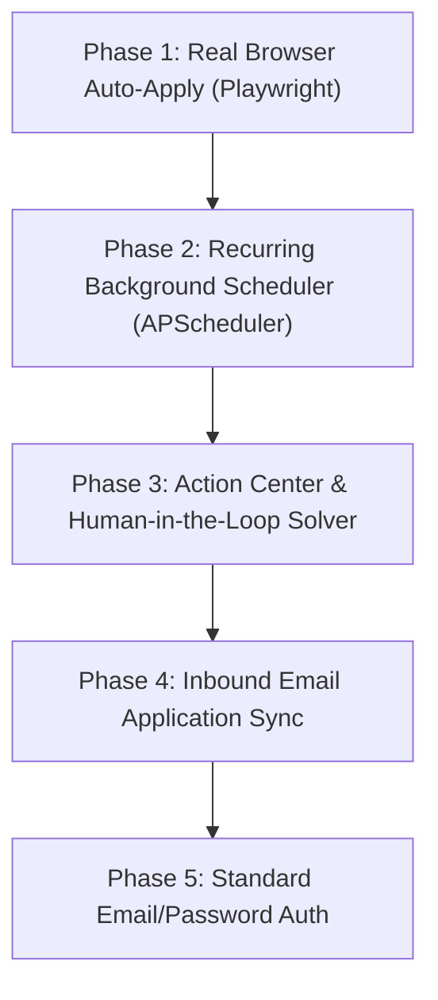

# Sleepy Apply — Project Status & Architecture Report

*Last Updated: November 5, 2026*  
*Environment: Development (Local Docker / FastAPI / Next.js / MongoDB)*

---

## 1. Executive Summary

**Sleepy Apply** is an autonomous AI-powered job application and discovery platform designed to find tech jobs (specifically tailored for Delhi NCR & Indian tech hubs), match them against candidate profiles using explainable AI scoring, generate tailored ATS-compliant resumes, and autonomously apply to positions.

This document details the current implementation status of all subsystems, identifying what is production-ready, what is partially implemented, and what key capabilities are still missing.

---

## 2. Feature Inventory & Current Status

| Subsystem / Feature | Current Status | Notes & File References |
| :--- | :--- | :--- |
| **Instant Resume Ingestion (<50ms)** | `✅ COMPLETED` | Fast heuristic parser hydrates fields in <50ms; asynchronous LLM deep-extraction runs in background. ([`profile.py`](backend/app/api/profile.py), [`profile_creator.py`](backend/app/agents/profile_creator.py)) |
| **Profile Management & Completeness Meter** | `✅ COMPLETED` | Continuous auto-fill, completeness score calculation, experience/project/skills editor. ([`page.tsx`](frontend/src/app/user/profile/page.tsx)) |
| **Dynamic Recruiter Screening Q&A** | `✅ COMPLETED` | Generates role-specific recruiter screening questions dynamically via local LLM; no static if/else role branching. ([`screening_agent.py`](backend/app/agents/screening_agent.py)) |
| **ATS Resume Templates & Live Preview** | `✅ COMPLETED` | Live dynamic paper preview for Default Clean ATS & Classic Ivy ATS; downloads real `.docx`. ([`ResumeTemplateSelector.tsx`](frontend/src/components/ResumeTemplateSelector.tsx), [`default.py`](backend/app/templates/default.py)) |
| **Dynamic Role-Based Job Search** | `✅ COMPLETED` | Sourcing prioritizes candidate-selected roles (`target_role` & `job_preferences.jobTitles`) with zero static fallback lists. ([`role_search.py`](backend/app/pipeline/role_search.py), [`job_fetcher.py`](backend/app/agents/job_fetcher.py)) |
| **LinkedIn Guest Sourcing** | `✅ COMPLETED` | Slices guest API with 14-day recency filter, polite 429 rate-limit backoff, and Delhi NCR hub targeting. ([`linkedin.py`](backend/app/sources/linkedin.py)) |
| **Naukri XML Sitemap Sourcing** | `✅ COMPLETED` | Daily official XML sitemaps parser (Delhi & Noida) matching URLs directly against user role tokens. ([`naukri.py`](backend/app/sources/naukri.py)) |
| **Indeed India RSS Sourcing** | `✅ COMPLETED` | Public RSS feed scraper targeting Delhi NCR, Gurugram, and Noida for user-selected roles. ([`indeed.py`](backend/app/sources/indeed.py)) |
| **Direct Company ATS Sourcing** | `✅ COMPLETED` | Direct API adapters for Greenhouse, Lever, Ashby, SmartRecruiters, and Workday across 40+ domestic tech unicorns. ([`company_ats.py`](backend/app/sources/company_ats.py)) |
| **Cross-Source Deduplication & Normalization**| `✅ COMPLETED` | Content hash deduplication, salary range extraction, and Delhi NCR tech hub standardization. ([`deduplicator.py`](backend/app/pipeline/deduplicator.py), [`normalizer.py`](backend/app/pipeline/normalizer.py)) |
| **Explainable Job Matcher** | `✅ COMPLETED` | Multi-factor scoring (0–100%) evaluating skills, seniority, domain, and location with matched/missing breakdown. ([`job_matcher.py`](backend/app/agents/job_matcher.py)) |
| **Multi-Provider AI Factory** | `✅ COMPLETED` | Unified adapter factory for Ollama (local llama3.2), OpenAI, Anthropic, Gemini, Groq, and DeepSeek. ([`providers/`](backend/app/providers/)) |
| **Candidate & Admin Dashboards** | `✅ COMPLETED` | Full Next.js UI for profile, job discovery, application filtering, and admin company controls. ([`frontend/src/app/`](frontend/src/app/)) |
| **Test Persona Switcher** | `✅ COMPLETED` | Modal switching between preloaded test candidates (Nishant, Suraj Singh, Abhishek Soni, Priya Sharma, etc.). ([`TestLoginModal.tsx`](frontend/src/components/TestLoginModal.tsx)) |
| **Discord Notifications** | `🟡 PARTIALLY DONE` | Outbound Discord webhook notifications for new job matches and submitted applications; 2-way bot commands not yet built. ([`discord_bot.py`](backend/app/agents/discord_bot.py)) |
| **Playwright SPA Scraper** | `🟡 PARTIALLY DONE` | Headless browser crawler written with route interception, but Playwright browser binaries are not installed in Docker container. ([`playwright_crawler.py`](backend/app/sources/playwright_crawler.py)) |
| **Per-Job Resume Tailoring** | `🟡 PARTIALLY DONE` | LLM tailoring prompt and schema ready, but end-to-end automated attachment to individual applications needs final wiring. ([`resume_builder.py`](backend/app/agents/resume_builder.py)) |
| **Autonomous Browser Form Submission** | `❌ MISSING` | Currently simulated in `form_applier.py`. Real Playwright form-filling for Greenhouse, Lever, and Ashby is not yet implemented. ([`form_applier.py`](backend/app/appliers/form_applier.py)) |
| **Background Recurring Scheduler (Cron)** | `❌ MISSING` | Currently triggers on-demand (upload, role change, fetch button). Standing automated cron (e.g. APScheduler / Celery Beat) is not yet active. |
| **CAPTCHA / Human-in-the-Loop Action Center**| `❌ MISSING` | Backend flags `REQUIRES_USER_ACTION`, but frontend lacks an interactive solver queue/modal for challenges. |
| **Inbound Email Application Tracking** | `❌ MISSING` | No Gmail/Outlook OAuth or IMAP sync to ingest rejections, interview invites, and confirmations. |
| **Standard Email / Password Authentication** | `❌ MISSING` | Currently only supports Discord OAuth2 and Dev Test Persona switching. |

---

## 3. Subsystem Breakdown

### 3.1 Candidate Profile & Ingestion Subsystem (`✅ COMPLETED`)
- **Instant Hydration Pipeline**:
  - `POST /api/profile/resume` runs instant heuristic regex parsing in `<50ms`, saving name, contact details, skills, and work history to MongoDB immediately.
  - Background LangGraph pipeline (`profile_pipeline.ainvoke`) executes asynchronous deep extraction and computes ATS completion scores.
  - LLM context window is strictly bounded (`num_ctx: 4096`) with strict 35s timeouts to prevent local model hangs.
- **Dynamic Recruiter Screening Engine**:
  - `POST /api/profile/screening/select-role` generates role-specific technical and recruiter verification questions based on the candidate's exact resume and chosen target role.
  - Zero hardcoded question templates or role branches; dynamic fallback is generated from the candidate's verified skills.

### 3.2 ATS Resume Engine (`✅ COMPLETED`)
- **Template System**:
  - **Default Clean ATS**: Modern, clean single-column dual-side header layout.
  - **Classic Ivy ATS**: Harvard monochrome standard layout with 100% ATS readability guarantee.
- **Dynamic Live Preview**:
  - Form field changes continuously re-render the SVG/HTML live paper preview in real-time.
  - One-click `.docx` generation generates formatted Word documents matching the candidate's live profile data.

### 3.3 Job Discovery & Normalization Pipeline (`✅ COMPLETED`)
- **100% User-Driven Role Targeting**:
  - Scrapers query using the unique roles selected by candidates across `db.profiles` (`target_role` and `job_preferences.jobTitles`).
  - No static hardcoded keywords or fallback arrays.
- **Sourcing Adapters**:
  - **LinkedIn**: Real guest API search targeting Delhi NCR (Gurugram, Noida, Delhi) with 14-day recency window and polite 429 rate-limiting backoff.
  - **Naukri**: Official daily XML sitemaps parser (Delhi & Noida), filtering URL slugs directly against candidate-selected role tokens.
  - **Indeed**: Public RSS feed parser targeting Delhi NCR tech hubs.
  - **Company ATS Portals**: API scrapers for Greenhouse, Lever, Ashby, SmartRecruiters, and Workday across Indian domestic tech companies and MNCs.
- **Normalization**:
  - Content hashing (`JobDeduplicator.compute_raw_hash`) prevents duplicate postings across multiple aggregators.
  - Standardizes Indian locations into primary tech hubs (Gurugram, Noida, Delhi NCR, Bengaluru, Pune, Hyderabad).

### 3.4 Job Matching Engine (`✅ COMPLETED`)
- **Multi-Factor Compatibility Algorithm**:
  - Evaluates candidate skills vs job required skills.
  - Verifies seniority alignment (Junior, Mid, Senior, Lead/Staff).
  - Matches candidate's selected role domain against job requirements.
  - Checks location compatibility (Delhi NCR vs remote vs other hubs).
- **Explainability**:
  - Provides detailed reasoning, list of matched skills, and list of missing skills for every matched job posting.
  - Automatically recalculates matches whenever a candidate selects a new target role.

### 3.5 AI Multi-Provider Integration (`✅ COMPLETED`)
- Factory architecture (`AIProviderFactory.resolve`) supports:
  - Local Ollama (`llama3.2:latest`, configurable context and temperature)
  - OpenAI (`gpt-4o-mini`, `gpt-4o`)
  - Anthropic (`claude-3-5-sonnet`)
  - Google Gemini (`gemini-1.5-pro`, `gemini-1.5-flash`)
  - Groq (`llama-3.3-70b-versatile`)
  - DeepSeek (`deepseek-chat`)

---

## 4. Key Gaps & What Needs to Be Built

### 4.1 Autonomous Browser Form Submission (`❌ MISSING`)
- **Current State**: [`form_applier.py`](backend/app/appliers/form_applier.py) detects external portals and CAPTCHA keywords, but logs a simulated application submission.
- **What is Needed**:
  1. Playwright automation scripts for major ATS platforms:
     - **Greenhouse** (`boards.greenhouse.io`): Form input autofill (Name, Email, Phone, Resume file upload, LinkedIn URL, custom question inputs).
     - **Lever** (`jobs.lever.co`): Form input autofill and file upload.
     - **Ashby** (`jobs.ashbyhq.com`): Multi-step form completion.
  2. Map screening Q&A answers from candidate profile directly into form questions.
  3. Real headless browser screenshot capture upon submission confirmation.

### 4.2 Background Task Scheduler / Recurring Automations (`❌ MISSING`)
- **Current State**: Discovery and matching only run when triggered by user action (resume upload, role selection, "Fetch Now" button) or admin API.
- **What is Needed**:
  1. Integrate **APScheduler** inside FastAPI or run a lightweight cron worker container.
  2. Scheduled intervals:
     - Job Discovery: Every 4–6 hours.
     - Auto-Apply Engine: Configurable time windows (e.g. Weekdays 9:00 AM – 6:00 PM).
     - Application Verifier: Daily check.

### 4.3 CAPTCHA & Human-in-the-Loop Action Center (`❌ MISSING`)
- **Current State**: When Cloudflare Turnstile, reCAPTCHA, or hCaptcha is detected, backend flags `status: "REQUIRES_USER_ACTION"`.
- **What is Needed**:
  1. Dedicated **"Needs Attention"** tab on the Jobs page.
  2. One-click button allowing candidate to open the application in their browser with prefilled data or solve the challenge.

### 4.4 Inbound Email Tracking & Status Sync (`❌ MISSING`)
- **Current State**: Application statuses (`APPLIED`, `INTERVIEW`, `REJECTED`) must be manually changed or inferred.
- **What is Needed**:
  1. Gmail / Outlook OAuth or IMAP inbox reader.
  2. Email classifier parsing applicant rejection notices, interview scheduling links, and ATS receipt acknowledgments.

### 4.5 Standard Authentication (`❌ MISSING`)
- **Current State**: Supports Discord OAuth2 and developer test persona switching.
- **What is Needed**:
  1. Traditional Email + Password registration with bcrypt hashing.
  2. Magic link passwordless login option.

---

## 5. Suggested Implementation Roadmap

1. **Step 1**: Install Playwright browser dependencies in backend Dockerfile and implement actual Greenhouse and Lever form-filler in `form_applier.py`.
2. **Step 2**: Add an `APScheduler` cron in `main.py` lifespan to run `job_pipeline.ainvoke({})` every 4 hours automatically.
3. **Step 3**: Add the "Action Required" UI tab on the frontend Jobs Board for any job flagged with CAPTCHA or external portal login.
4. **Step 4**: Implement Google Workspace / Gmail API sync to detect interview invites and rejections automatically.

